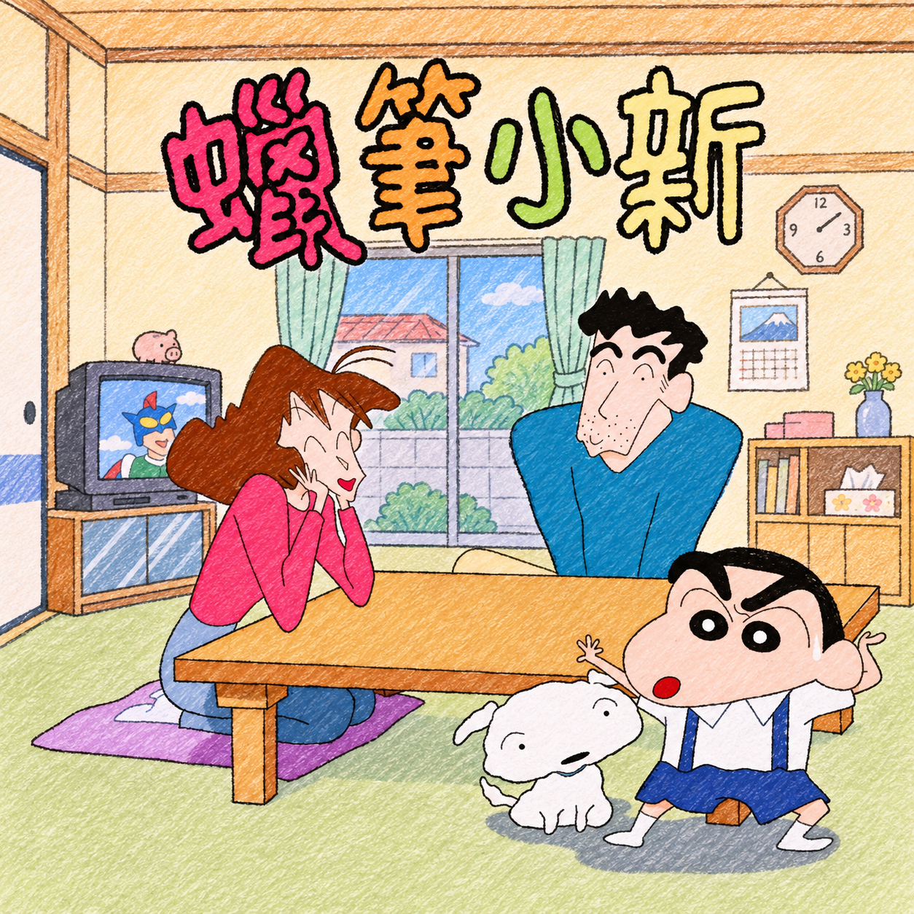
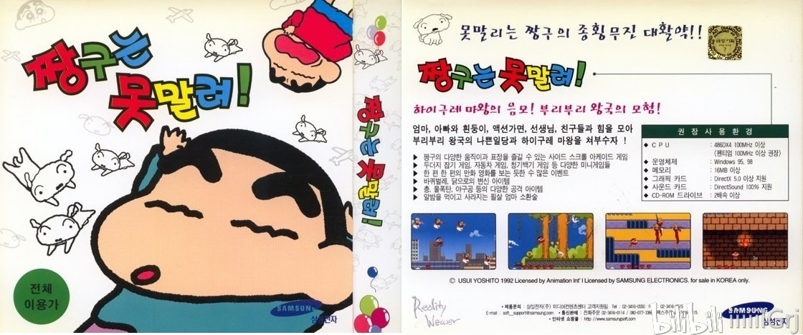
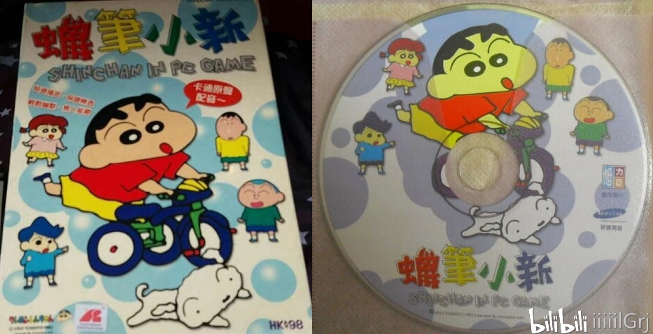
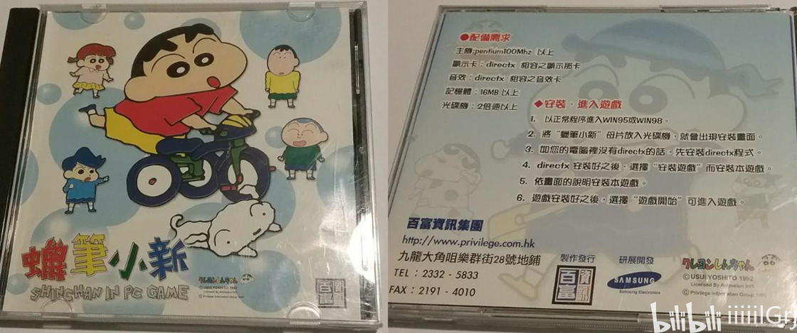

# SHIN Rebuild · 蜡笔小新初代重建



使用 C++17 重建蜡笔小新初代横版闯关游戏，支持 Windows 和 Nintendo Switch。希望在保留原作玩法与童年记忆的同时，让这款老游戏更适合现代设备运行。

项目借助 AI 辅助开发，目前已完成可体验的初步重建，包含七关流程、小游戏、存档与宽屏支持。部分敌人行为、Boss 战和剧情演出仍需继续对照原版，尚不代表逐帧还原完成。

## 原作简介

根据目前整理的资料，初代《蜡笔小新～剧场版》由 Reality Weaver 制作，三星电子于 1997 年 7 月发行韩语版。繁体中文版本包括由台湾旭力亞數碼科技股份有限公司代理、于 1999 年 7 月 15 日发行的国语配音版，以及香港百富资讯集团代理的粤语配音版。以上发行信息来自项目作者整理的文档，欢迎提供原始资料补充、校正。

这是一款横版闯关游戏。小新除了移动、跳跃和收集道具，还能借助道具变身，例如以蟑螂形态冲击、以公鸡形态飞行，也可以召唤家人和朋友协助闯关。主线中还穿插了多种小游戏。

## 三个地区的原版版本

以下图片及版本信息整理自项目作者提供的《蜡笔小新初代》文档，用于介绍原作的不同地区版本。图片保留文档中的原貌和已有水印；发行日期、代理信息仍欢迎补充原始资料核对。

### 韩国版 · 韩语

根据作者整理的资料，韩语版由 Reality Weaver 制作、三星电子于 **1997 年 7 月**发行。下图展示其包装正反面，可见韩文标题及游戏截图。



### 台湾版 · 繁体中文／国语配音

根据作者整理的资料，台湾版由 **旭力亞數碼科技股份有限公司**代理，于 **1999 年 7 月 15 日**发行。下图为包装及光盘，采用繁体中文文字与国语配音。



### 香港版 · 繁体中文／粤语配音

根据作者整理的资料，香港版由 **百富资讯集团**代理，采用繁体中文文字与粤语配音。这也是作者童年接触、后来希望重新体验的版本；目前整理的文档未提供确切发行日期。



这些图片仅作为版本介绍资料提供，不包含三个地区的原版游戏程序或可运行资源。包装、美术、角色及照片的相关权利归各自权利人所有，不适用本仓库的代码许可证。详见 [版本图片说明](docs/images/editions/NOTICE.md)。

## 为什么重建这个游戏

小时候，大概是在九十年代，爸爸给我买回了一张港版《蜡笔小新》。我玩了很久，那时觉得游戏挺难，它也成了我的游戏启蒙之一。

长大后想再玩时，才发现当年的正版光盘因为保存不当，已经断成了两块。后来在网上寻找了很久，才重新搜集到港版和台版的游戏资源。

重新运行后，我发现部分声音素材似乎有所缺失，而这款面向 Windows 98 时代的游戏，在现代电脑上的兼容性和运行体验也不够理想。于是，我萌生了重建它的想法，希望让自己和同样记得这款游戏的人，能够更方便地重新体验它。

借助 AI 的辅助，项目目前已经完成初版制作，也陆续处理了原发行版中的部分贴图错位、画面卡顿等问题，并对部分反应时间和战斗难度做了调整。这些调整会尽量保留原作的风格，但项目仍在完善中，欢迎反馈与原版不一致的地方。

## 当前重建内容

- 七关主线、关内机关、剧情触发与 Boss 流程的接入和持续校正。
- 小游戏入口、存档解锁、可配置的得分奖励机制。
- 宽屏与超宽屏适配、菜单布局修正，以及相机跟随和绘制顺序修复。
- Windows 窗口／全屏切换；Switch 图标、启动诊断和存档兼容性处理。

已接入的流程仍需要人工体验和原版对照。当前已知部分音效在现有原版资源中缺失；项目没有用不对应的声音替代它们。运行结果也会受使用的资源版本影响。

## 源码与素材

本仓库发布重建源码、配置、测试输入、项目作者创作并提供的展示图，以及用于原作版本介绍的包装和光盘图片。**不包含原版游戏程序、提取贴图、音效、音乐、密钥或安装包。** 请自行取得可合法使用的原版资源，勿将其提交到仓库。原作名称和角色等权利归各自权利人所有。

顶部图片《蜡笔小新温馨客厅时光》由项目作者 **lilmik** 创作并提供，用于项目展示及图标。它不是从原版程序提取的素材；图片的使用说明见 [展示图说明](docs/images/NOTICE.md)。

## Windows 构建

需要 CMake 3.20+、Visual Studio 2022 C++ 工具与 Windows SDK。

```powershell
cmake -S . -B build
cmake --build build --config Release --target shin_progress
```

生成 `build/Release/SHIN_Level1.exe`。资源目录应包含 `RESOURCE.RES`、`RESOURCE/`、`bgm/` 和原版 `_inmm.ini`。将该目录复制到可执行文件旁的 `assets/`，或指定资源档案：

```powershell
.\build\Release\SHIN_Level1.exe --assets "你的资源目录/RESOURCE.RES" --width 1280 --height 720
```

方向键移动/跳跃，空格使用武器，Enter 暂停/确认，Esc 返回菜单，F11 切换全屏。

## 测试

不需要游戏素材的测试可由 CMake 构建。依赖素材的测试在配置时通过 `-DSHIN_ASSET_FILE="你的资源目录/RESOURCE.RES"` 启用。测试输入 `.keys` 文件是文本按键脚本，不是加密密钥。

## Nintendo Switch

`switch/` 包含基于 libnx、SDL2、SDL2_mixer 的移植。构建脚本使用固定版本 devkitPro Docker 镜像，需要 Docker，并显式传入本地素材目录：

```powershell
.\switch\build_switch.ps1 -Assets "你的资源目录"
```

Switch 图标可使用作者提供的 [展示图](docs/images/living-room.png)，将其等比缩小并导出为 `switch/icon.jpg`（256×256 baseline JPEG）。安装包工具 hacBrewPack 未随仓库分发；使用 `package_nsp.ps1` 前须自行准备经核对许可的工具及其依赖于 `switch/tools/hacBrewPack/`。个人密钥仅在本机使用，不要提交。Switch 构建与安装有独立环境要求，仓库不保证未经实机验证的设备兼容性。

## 状态

包含七关、小游戏、存档、宽屏与 Windows 图形界面启动支持。敌人行为、演出和部分场景仍有待与原版核对。开发工具中部分审计脚本需要另行准备的本地逆向分析资料，不属于无资源条件下可直接运行的测试。

## 许可证

本项目可授权的重建代码采用 **GPL-3.0-only**，详见 [LICENSE](LICENSE)。第三方组件遵循各自许可证，见 [THIRD_PARTY.md](THIRD_PARTY.md)。该许可证不授予原版游戏素材、商标或角色的使用和分发权，也不自动适用于作者另行提供的展示图。
